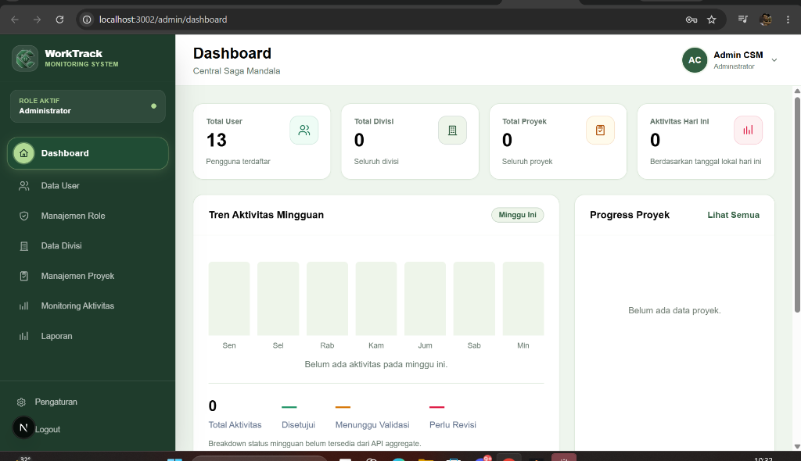
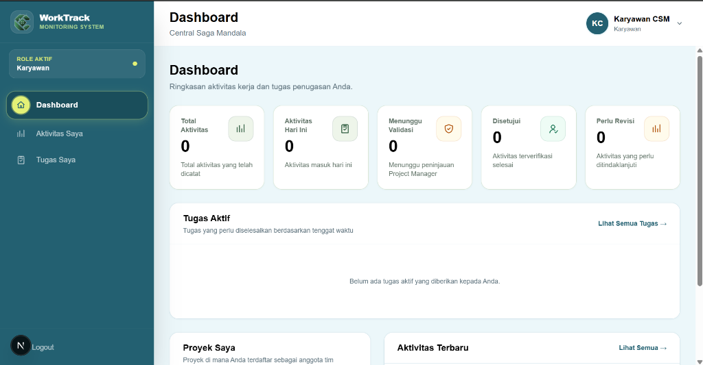
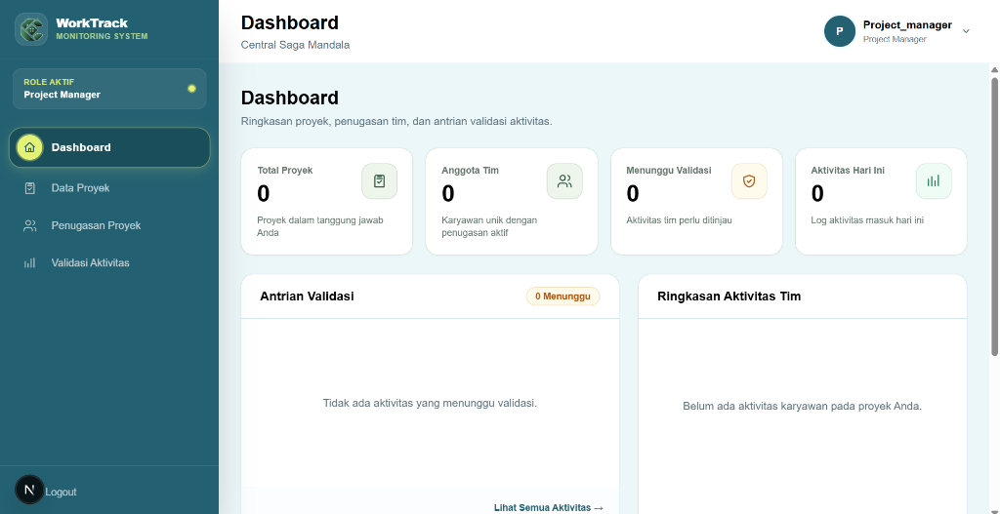

# Monitoring Aktivitas CSM

Aplikasi internal untuk mencatat aktivitas kerja dan mengelola proyek, penugasan, review aktivitas, pengguna, divisi, serta hak akses di Central Saga Mandiri.

## Fitur

- Dashboard Admin, Project Manager, dan Karyawan.
- Login berbasis token dengan hak akses sesuai role.
- Pengelolaan pengguna, divisi, role, proyek, dan assignment.
- Pencatatan aktivitas, lampiran bukti, antrean review, dan permintaan revisi.
- Task proyek, filter/pencarian, laporan, serta ekspor laporan.
- Loading, error, dan empty state saat data API dimuat atau tidak tersedia.

## Teknologi

- Frontend: Next.js 16, React 19, TypeScript, Tailwind CSS.
- Backend: Laravel 13, PHP 8.4, Sanctum, Spatie Permission.
- Data dan layanan: PostgreSQL 17, Redis 7, queue worker.
- Container: Docker Compose atau Podman Compose.

## Menjalankan dengan Compose

Persyaratan: Git dan Docker Compose v2, atau Podman beserta `podman-compose`.

```bash
git clone https://github.com/Central-Saga/Alexandro-KP-MonitoringAktivitas.git
cd Alexandro-KP-MonitoringAktivitas
docker compose up -d --build
```

Compose membangun dependency, menunggu PostgreSQL dan Redis siap, menjalankan migrasi, lalu menyalakan backend, queue worker, dan frontend. Frontend tersedia di <http://localhost:3002> dan API backend di <http://localhost:8000>.

Untuk membuat akun demo dan data pengguna:

```bash
docker compose exec backend php artisan db:seed
```

Ganti `docker compose` dengan `podman-compose` jika menggunakan Podman. Seeder menyediakan akun demo berikut (password untuk penggunaan lokal/demo saja):

| Role | Email | Password |
| --- | --- | --- |
| Admin | `admin@csm.com` | `password123` |
| Project Manager | `project_manager@csm.com` | `password123` |
| Karyawan | `karyawan@csm.com` | `password123` |

Hentikan layanan dengan `docker compose down`. Untuk menghapus database dan volume dependency lalu memulai ulang dari keadaan kosong, gunakan `docker compose down -v` diikuti `docker compose up -d --build`.

Compose memakai APP_KEY lokal bawaan untuk demo. Sebelum deployment, isi `APP_KEY` dengan key acak dan atur `CORS_ALLOWED_ORIGINS` ke origin frontend yang benar. Contoh variabel tersedia di [.env.example](.env.example).

## Menjalankan backend tanpa container

```bash
cd Backend
cp .env.example .env
composer install
php artisan key:generate
php artisan migrate --seed
php artisan serve
```

Ubah konfigurasi database dan Redis di `Backend/.env` agar sesuai layanan lokal yang tersedia. Untuk frontend lokal di terminal lain:

```bash
cd Frontend
cp .env.example .env.local
npm ci
npm run dev
```

Frontend lokal berjalan di <http://localhost:3000>. Pastikan `Backend/.env` mengizinkan origin tersebut lewat `CORS_ALLOWED_ORIGINS`.

## Menjalankan frontend mode produksi

Dockerfile di `Frontend/` menjalankan `npm run dev`, jadi khusus development. Untuk build produksi:

```bash
cd Frontend
cp .env.example .env.local      # isi NEXT_PUBLIC_API_URL ke API yang dipakai browser
npm ci
npm run build
npm start                       # Next.js start di port 3000
```

Atau lewat container multi-stage `Frontend/Dockerfile.prod` (deps → build → runner):

```bash
docker build -f Frontend/Dockerfile.prod   --build-arg NEXT_PUBLIC_API_URL=http://localhost:8000/api   -t monitoring-frontend:prod Frontend
docker run -p 3000:3000 monitoring-frontend:prod
```

Catatan: variabel `NEXT_PUBLIC_*` di-inline Next.js saat build, jadi nilainya harus sudah benar pada tahap `npm run build` / `docker build` — bukan saat container dijalankan.

## Menjalankan pemeriksaan

```bash
cd Backend
php artisan test

cd ../Frontend
npm run lint
npm run build
```

## Screenshot

Berikut adalah tampilan antarmuka sistem Monitoring Aktivitas CSM:


*Gambar 1: Dashboard Utama Admin*


*Gambar 2: Dashboard & Aktivitas Karyawan*


*Gambar 3: Dashboard & Validasi Aktivitas Project Manager*
